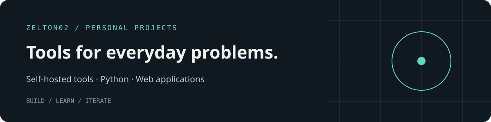

# Hi, I'm Zhi Heng 👋

### Selected projects

| Project | What it does | Built with |
| :--- | :--- | :--- |
| **[Jalan](https://github.com/zelton02/jalan)** | Trip planner for Malaysian rail and bus on the government's open GTFS data: RAPTOR routing, live bus positions, hourly punctuality and walking directions. In development. | Node.js · TypeScript · React · SQLite · Docker |
| **[Keystone](https://github.com/zelton02/keystone)** | A design-system engine that turns design taste into checkable rules: a token builder (`tokens.json` → CSS variables) and a drift audit for AI-maintained UI. Jalan is its first consumer. | JavaScript · Node.js |
| **[Mi Sleep Sync](https://github.com/zelton02/mi-sleep-sync)** | Self-hosted Xiaomi sleep sync with sleep stages, SQLite storage, JSON exports, and optional Hermes integration. | Python · SQLite |
